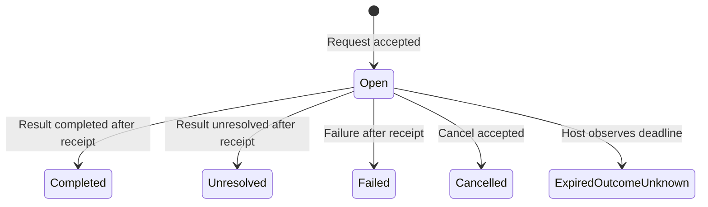

# Design decision: one envelope, optional task rules, explicit routes

## Alternatives considered

| Design | Useful cases | Costs and limitations |
|---|---|---|
| Pairwise session protocols | Small peer systems, direct streaming, independently hosted agents | Each session must solve recovery and correlation; cross-session budgets and workflow state need another mechanism. |
| Central task broker with a fixed supervisor | Dispatch, retry, aggregation, simple worker pools | Treats mesh and hierarchical exchanges as supervisor operations; the broker's workflow vocabulary can constrain new patterns. |
| Versioned envelope, durable delivery and optional application profiles | Star, mesh, tree, pipelines, peer handoffs, review loops, routing, fan-out and input-dependent orchestration | Requires an explicit profile and host adapter. This implementation uses one local SQLite database; remote transport remains a separate implementation obligation. |

All three designs can be extended to support the requested workflows. The third is selected because one reusable core supports every supplied example without imposing a supervisor on application semantics. It separates message representation, delivery, task transitions and substantive result checking. This is an engineering judgement about the declared use cases, not a benchmark proving universal superiority. A pairwise streaming protocol remains preferable where stream latency or independent remote ownership dominates; a fixed broker can be simpler for a homogeneous queue of jobs.

The protocol implementation is Rust throughout: nom recognition, exact JSON values, SQLite transactions, application validation, CLI, fixtures and verification orchestration. Promela specifies the abstract systems; SPIN generates C verifiers. The core requires no Python service or model API. An optional [reusable Python host](host-runner.md) connects trusted application adapters and OpenAI model calls to the existing Rust gateway; it does not duplicate protocol validation or storage. The gateway remains a local stdio interface.

## Reapplying Holzmann

Holzmann's five specification elements guide the protocol contract: service, environment, vocabulary, encoding and exchange rules. Requirements precede implementation structure. Independent concerns remain separate. Executable models test deadlock and progress assumptions; deliberate defects challenge the properties. Implementation tests check correspondence with model actions. No formal refinement proof is claimed. These choices apply §§2.2 and 2.7–2.8 of *Design and Validation of Computer Protocols* (1991), printed pp. 21, 35–39; the book is linked, not redistributed.

## Service and environment

A trusted host registers participants and a directed communication graph, then exchanges validated messages in a durable local mailbox. Actors may represent agents, tools or a human-facing adapter. The capability gateway authenticates an agent's requests and derives its run and actor from host-provisioned credentials. The embedded Store and administrative CLI remain privileged interfaces with host-asserted actors. Agents must not have direct database or credential-file access. The graph describes logical permission to exchange messages. A mesh configuration still uses central SQLite; remote transport and its failure/security contract remain separate implementation obligations.

Each send is accepted atomically, recognised as an identical resend, or rejected without inserting its proposed message. Independent expiry reconciliation and gateway attempt accounting can still commit when a send is rejected. Receive marks addressed messages as received and returns unacknowledged messages in insertion order. Acknowledgement records that the recipient received the message. It says nothing about task completion, truth, proof checking or an external side effect.

The runtime rejects malformed, unauthorised and contradictory participant requests. Transactions can fail: failure before the message/task transaction commits preserves its preceding state; independent expiry and attempt-accounting transactions may already have committed. A lost response after message commit can be recovered by an identical retry. The remaining storage premise is atomicity and durability of committed SQLite transactions, including functioning filesystem locks and flushes. Accepted records and identifiers remain for the run. Credential confidentiality, correct host isolation, storage corruption and remote cryptographic security are outside the finite-model guarantees. Truthful or cooperative agent output is not required for admission safety.

Run configuration freezes participants, edges, application profile, per-recipient unacknowledged capacity, total message/byte/call budgets and a wall-clock send/call deadline. Queue pressure rejects a send without dropping accepted messages. Receive and ack remain available after the deadline so history can drain. A full mailbox can reject a cancellation. Independently, host reconciliation records every still-open task as `expired_outcome_unknown` once expiry is observed, without allocating a message or consuming its budget. The stored closed state survives restart and clock rollback. The send/call cutoff is checked inside the write transaction; its physical commit may complete after that clock observation. Deadline detection still relies on the host clock and execution; it makes no hard real-time promise.

The gateway durably charges attempted operations separately from accepted-message and model-call budgets. Invalid syntax, invalid credentials and rejected operations consume the global attempt allowance. Authenticated attempts also consume their credential allowance. Exhausting the global allowance stops the service; reopening does not reset its counters. This bounds processed requests and parser work per frozen policy, not idle-input delay, all host CPU use, or provider work performed outside the host adapter. See [gateway configuration and usage](gateway.md).

## Representation

The unchanged version-1 envelope has seven fields:

| Field | Meaning |
|---|---|
| `message_id` | Unique within `run_id`, retained after acknowledgement. |
| `run_id` | Conversation and identity-retention scope. |
| `sender`, `recipient` | Explicit registered participants on an allowed directed edge. |
| `version` | Wire version; currently `1`. |
| `kind` | Application vocabulary name. |
| `payload` | Exact JSON object; never an instruction to execute arbitrary code. |

```text
message "q1" run "demo" from "hub" to "worker" version "1" kind "Request" payload {"input":{"values":[2,3]},"operation":"sum","task_id":"t1"};
```

The compositional nom parser consumes the complete input and rejects trailing text, duplicate keys, malformed identifiers, invalid Unicode, non-integer JSON numbers and oversized values. Wire limit: 65,536 UTF-8 bytes; container nesting: 32; integer size: 1,024 decimal digits. Use explicit rational records or decimal strings under an application schema. Model statements, assumptions, units and certificate references remain payload data. Parser acceptance does not establish their correctness.

Canonical encoding sorts object keys through `serde_json::Map` and preserves exact integer representation. The runtime retains canonical content, not merely a hash. Reusing `(run_id,message_id)` with changed content is rejected, even after acknowledgement. This supports idempotent message insertion, not exactly-once agent execution. There is no identity expiry, adaptive grammar activation or negotiation during a run; incompatible versions are rejected. A new profile/version requires an explicit new contract and compatibility tests.

## Task profile `agent-task/1`

The generic transport accepts any valid kind. The optional task profile constrains each `(run_id,task_id)` to one request and at most one terminal response. Task-transition validation, message insertion and the task-ledger update share one database write transaction.

| Kind | Required payload fields | Preconditions and meaning |
|---|---|---|
| `Request` | `task_id`, `operation`, `input` | Fresh task identity; `input` is an object; the worker has a permitted reverse route for its Result or Failure. An operation declares requested work, never grants tool permissions. |
| `Result` | `task_id`, `reply_to`, `status`, `output` | Exact request message ID; reversed participants; request received; task open. Status `completed` or `unresolved`; output is an object. Both are terminal reports. |
| `Failure` | `task_id`, `reply_to`, `reason` | Same correlation, reverse participants and receipt requirements; non-empty reason. Terminal failure. |
| `Cancel` | `task_id`, `reply_to`, `reason` | Requester's original direction, exact request ID, task open; non-empty reason. Terminal cancellation when accepted. |

The first committed terminal transition wins a race between result, cancellation and runtime-observed expiry. Expiry writes a task record, not a fabricated worker message. An accepted cancellation records protocol closure, not confirmed worker stoppage. Neither cancellation nor expiry undoes external effects. Identical message resends retain their original acceptance; conflicting or late fresh terminal messages fail. Closed queued requests remain available as history with `actionable: false`; a host must check that field before starting work. The value is a snapshot, not an exclusive execution lease. Forwarding through a hub or team lead creates a new request with a new identity and explicit context. Workflow dependencies belong to the host; routing edges do not imply a tree of obligations.

New task Requests with a missing reverse response route are rejected as
`forbidden_route` before message or task insertion. The rule applies only to
new `agent-task/1` requests: generic one-way messages remain permitted, and
identical resends retain their earlier acceptance even if the historical
request predates this check. Existing run configuration and records need no
migration. A return route permits a response; it does not guarantee execution,
capacity for that response or task completion.



Read receipts and acknowledgements are mailbox state, independent of this task state. A reply may follow receive before ack. Valid termination of a workflow must be specified by its caller. Arbitrary conjectures need an unresolved outcome; no eventual proof or refutation is promised.

## Typed admission and recovery

Rust callers can use `Store::send_checked` or
`ProtocolRepository::send_checked`. Successful receipts retain the existing
`accepted`, `duplicate` and `sequence` fields. Failures expose an
`AdmissionError` with stable `code`, `disposition` and explanatory `message`;
`to_value()` supplies its JSON representation.

| Disposition | Established fact | Caller action |
| --- | --- | --- |
| `rejected` | This attempt was refused by a validation, identity, routing, deadline or budget rule. | Correct the cause; preserve any already accepted identity and content. |
| `retryable` | This attempt was refused because its recipient's mailbox was full. | After capacity becomes available, retry the identical message within the caller's attempt and time limits. |
| `unknown` | The repository could not establish the admission outcome. | Reconcile the original identity. A missing observation does not establish that an outstanding operation cannot still commit. |

The concrete codes are `invalid_message`, `unknown_run`, `unknown_actor`,
`actor_mismatch`, `unknown_recipient`, `forbidden_route`, `identity_conflict`,
`deadline_exceeded`, `unsupported_version`, `budget_exceeded`, `mailbox_full`,
`invalid_transition` and `outcome_unknown`. Database failures are conservatively
`unknown`, including failures before commit; diagnostic strings never determine
retry permission. Independent deadline reconciliation may commit even when
message admission is refused. Identical resends continue to return their retained
acceptance, including after the deadline or while the mailbox is full.

`send` remains a compatibility wrapper returning its original string errors.
The command-line and legacy gateway `send` retain their existing response
formats. The additive gateway commands `send_checked` and `reconcile_message`
require the explicit `mas-admission/1` profile; persistent host IPC carries them
through its existing `gateway` operation. Checked failures disclose stable codes
and dispositions, never private repository diagnostics. Older custom repository
implementations remain source compatible: the default `send_checked` delegates
to their `send` and marks every untyped error `unknown`. They must override that
method to establish more specific outcomes.

`Store::reconcile_message` and `ProtocolRepository::reconcile_message` observe
one sent identity for the bound run and actor without receiving messages,
acknowledging them or reconciling expiry. `present` returns only its sequence and
receipt flags; `absent` makes no distinction between a missing identity and an
identity belonging to another actor or run. Neither result discloses a payload.
Absence means no matching committed message was visible in that snapshot. An
outstanding send may still commit later; absence never authorises a replacement
identity or repetition of an external effect. A custom repository without this
capability returns an `unknown` outcome. See [gateway recovery](gateway.md).

These dispositions describe admission into a mailbox. They do not establish
whether a recipient started, completed or verified an external operation.
Operation identity, target preconditions, execution authority and evidence of
external effects belong to the host and its adapters. Incident response uses the
same message envelope and task contract as other applications; it introduces no
remediation-specific protocol profile.

## Read-only observation

`observation::Observer::open(path)?.snapshot(run_id, include_payloads)` opens an
existing SQLite database read-only and validates its native version-2 schema.
It neither creates nor migrates databases. `Store::observe` and
`ProtocolRepository::observe` expose the same snapshot contract for an already
open repository. A snapshot reports committed state without expiry
reconciliation, message delivery or acknowledgement; a deadline may therefore
have passed while a retained task still reads `open`.

The result is versioned `mas-protocol-observation/1`, with `run_id`,
`payloads_included`, `run`, `messages`, `calls` and `tasks`. `run` contains frozen
configuration, deadline, usage, active protocol and recorded expiry. Message
records contain sequence, envelope identities, kind, receipt flags and task
correlation. Payloads and call evidence appear only with explicit opt-in.
Retained envelope content is validated against its identity columns before
disclosure. The caller still controls filesystem or database permissions and
must authorise disclosure of the remaining routing metadata.

PostgreSQL observation uses a repeatable-read, read-only transaction. It checks
the bound deployment, controller, epoch, schema version and applicable recovery
and lease guards without locking authority rows or renewing leases. A snapshot
is an observation of that transaction's state, never an execution lease or a
history of every transition. Default observation on an older custom repository
returns an explicit unsupported error rather than calling mutating `inspect`.

## Reducing assumptions

| Option | Benefit | Remaining condition |
|---|---|---|
| Add retries or stronger scheduler fairness | Can help delivery when a receiver eventually accepts work. | Endless faults or permanent worker failure still prevent success. |
| Move identity and quotas into a trusted admission boundary | Enforces actor binding and charges rejected attempts. | Credentials and the host boundary must remain protected. |
| Add runtime-owned expiry with durable task state | Reconciles unanswered tasks despite exhausted communication resources. | The host must execute reconciliation against available storage; expiry does not resolve external effects. |

The latter two are combined, and verification separates safety from progress.
Bounded progress no longer declares redundant weak process fairness. Additional
finite models allow faults to repeat indefinitely when checking safety. Their
progress counterexamples are retained rather than suppressed by new premises.
For external effects, an adapter can additionally use an idempotency key and a
transactional outbox; a downstream system must honour that key. This generic
protocol does not claim exactly-once execution of arbitrary external actions.

## Extension boundaries

This protocol can carry model calls, structured telemetry, proposed proofs, critiques, human decisions and tool results. Their content schemas and acceptance checkers belong to explicit profiles or adapters. A proposed theorem requires its independent designated proof checker; a vote or `completed` message cannot replace one. The Rust fixtures execute deterministic functions to test communication. The Python mesh adds explicitly selected mock or live OpenAI execution. Neither language-model quality nor comparative productivity is measured by protocol tests.

Frozen membership supports bounded input-dependent allocation to a registered pool. Truly dynamic agent spawning requires host execution and either a pre-registered bounded pool or a separately versioned membership protocol. The latter is not claimed here. Streaming, distributed consensus, globally exclusive handoff ownership, multi-database transactions and remote transport are not supplied by the local mailbox.

## Sources

Accessed 13 October 2026.

- [Holzmann, Design and Validation of Computer Protocols (1991)](https://www.theswissbay.ch/pdf/Gentoomen%20Library/Networking/Design_and_Validation_of_Computer_Protocols_-_Gerard_Holzmann.pdf).
- [SPIN manual: simulation and verifier generation](https://spinroot.com/spin/Man/Spin.html), [generated verifier](https://spinroot.com/spin/Man/Pan.html), [inline LTL](https://spinroot.com/spin/Man/ltl.html), [atomic operations](https://spinroot.com/spin/Man/atomic.html).
- [SQLite atomic commit](https://www.sqlite.org/atomiccommit.html): transaction recovery and the operating-system/storage contract.
- [Requested topology glossary](https://agenticorgchart.com/glossary/): retrieved directly over HTTPS after the web reader failed; source hash and term names retained in `evidence/source-access.json`. Its names guide coverage; the protocol contracts are this project's engineering design.
- [Requested workflow catalogue](https://buildingeffectiveagents.com/patterns/) and its primary source, [Schluntz and Zhang, Building effective agents (19 December 2024)](https://www.anthropic.com/engineering/building-effective-agents). The five workflows guide examples, not claims about the current state of every agent framework.
