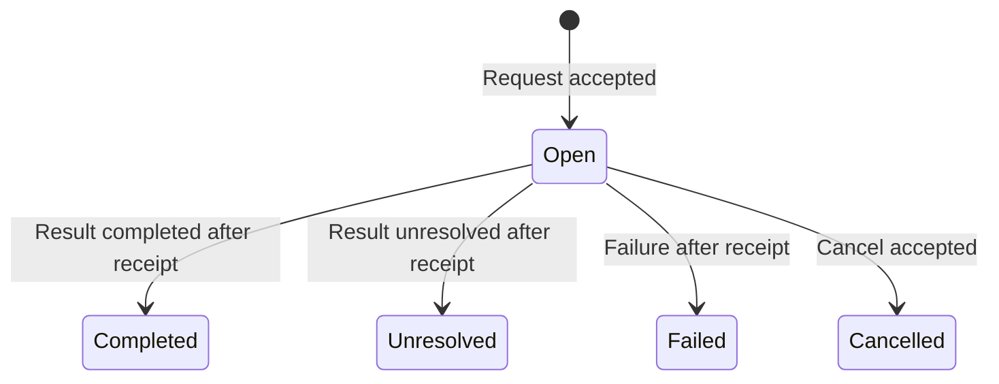

# Design decision: one envelope, optional task rules, explicit routes

## Alternatives considered

| Design | Useful cases | Costs and limitations |
|---|---|---|
| Pairwise session protocols | Small peer systems, direct streaming, independently hosted agents | Each session must solve recovery and correlation; cross-session budgets and workflow state need another mechanism. |
| Central task broker with a fixed supervisor | Dispatch, retry, aggregation, simple worker pools | Treats mesh and hierarchical exchanges as supervisor operations; the broker's workflow vocabulary can constrain new patterns. |
| Versioned envelope, durable delivery and optional application profiles | Star, mesh, tree, pipelines, peer handoffs, review loops, routing, fan-out and input-dependent orchestration | Requires an explicit profile and host adapter. This implementation uses one local SQLite database; remote transport remains a separate implementation obligation. |

All three designs can be extended to support the requested workflows. The third is selected because one reusable core supports every supplied example without imposing a supervisor on application semantics. It separates message representation, delivery, task transitions and substantive result checking. This is an engineering judgement about the declared use cases, not a benchmark proving universal superiority. A pairwise streaming protocol remains preferable where stream latency or independent remote ownership dominates; a fixed broker can be simpler for a homogeneous queue of jobs.

The executable implementation is Rust throughout: nom recognition, exact JSON values, SQLite transactions, application validation, CLI, fixtures and verification orchestration. Promela specifies the abstract systems; SPIN generates C verifiers. No Python service or model API is required. No provider, framework or remotely authenticated service is implemented implicitly.

## Reapplying Holzmann

Holzmann's five specification elements guide the protocol contract: service, environment, vocabulary, encoding and exchange rules. Requirements precede implementation structure. Independent concerns remain separate. Executable models test deadlock and progress assumptions; deliberate defects challenge the properties. Implementation tests check correspondence with model actions. No formal refinement proof is claimed. These choices apply §§2.2 and 2.7–2.8 of *Design and Validation of Computer Protocols* (1991), printed pp. 21, 35–39; the book is linked, not redistributed.

## Service and environment

A trusted host registers participants and a directed communication graph, then exchanges validated messages in a durable local mailbox. Actors may represent agents, tools or a human-facing adapter. An actor name supplied by an untrusted caller is not authentication. The graph describes logical permission to exchange messages. A mesh configuration still uses this central SQLite transport; it is not a decentralised network. A network service would need authenticated sessions, authorisation, transport framing and a separately modelled failure contract.

Each send is accepted atomically, recognised as an identical resend, or rejected without advancing the conversation. Receive marks addressed messages as received and returns unacknowledged messages in insertion order. Acknowledgement records that the recipient received the message. It says nothing about task completion, truth, proof checking or an external side effect.

Assumptions are a functioning SQLite database on a local filesystem, successful atomic transactions, a trusted host identity mapping and persistent retention for the run. A process can stop between operations and reopen the database. Accepted records and their identifiers remain. Storage corruption, dishonest host identity, Byzantine participants, network partitions and remote cryptographic security are outside this implementation's assurance claims.

Run configuration freezes participants, edges, application profile, per-recipient unacknowledged capacity, total message/byte/call budgets and a wall-clock send/call deadline. Queue pressure rejects a send; it does not drop an accepted message. The caller may retry within budget. Receive and ack remain available after the deadline so accepted messages can drain. A full mailbox can reject a cancellation too. No deadline produces a task result automatically.

## Representation

The unchanged version-1 envelope has seven fields:

| Field | Meaning |
|---|---|
| `message_id` | Unique within `run_id`, retained after acknowledgement. |
| `run_id` | Conversation and identity-retention scope. |
| `sender`, `recipient` | Explicit registered participants on an allowed directed edge. |
| `version` | Wire version; currently `1`. |
| `kind` | Application vocabulary name. |
| `payload` | Exact JSON object; never an instruction to execute arbitrary code. |

```text
message "q1" run "demo" from "hub" to "worker" version "1" kind "Request" payload {"input":{"values":[2,3]},"operation":"sum","task_id":"t1"};
```

The compositional nom parser consumes the complete input and rejects trailing text, duplicate keys, malformed identifiers, invalid Unicode, non-integer JSON numbers and oversized values. Wire limit: 65,536 UTF-8 bytes; container nesting: 32; integer size: 1,024 decimal digits. Use explicit rational records or decimal strings under an application schema. Model statements, assumptions, units and certificate references remain payload data. Parser acceptance does not establish their correctness.

Canonical encoding sorts object keys through `serde_json::Map` and preserves exact integer representation. The runtime retains canonical content, not merely a hash. Reusing `(run_id,message_id)` with changed content is rejected, even after acknowledgement. This supports idempotent message insertion, not exactly-once agent execution. There is no identity expiry, adaptive grammar activation or negotiation during a run; incompatible versions are rejected. A new profile/version requires an explicit new contract and compatibility tests.

## Task profile `agent-task/1`

The generic transport accepts any valid kind. The optional task profile constrains each `(run_id,task_id)` to one request and at most one terminal response. All validation and insertion occur in the same database write transaction.

| Kind | Required payload fields | Preconditions and meaning |
|---|---|---|
| `Request` | `task_id`, `operation`, `input` | Fresh task identity; `input` is an object. An operation declares requested work, never grants tool permissions. |
| `Result` | `task_id`, `reply_to`, `status`, `output` | Exact request message ID; reversed participants; request received; task open. Status `completed` or `unresolved`; output is an object. Both are terminal reports. |
| `Failure` | `task_id`, `reply_to`, `reason` | Same correlation, reverse participants and receipt requirements; non-empty reason. Terminal failure. |
| `Cancel` | `task_id`, `reply_to`, `reason` | Requester's original direction, exact request ID, task open; non-empty reason. Terminal cancellation when accepted. |

The first accepted terminal message wins a race between result and cancellation. A cancellation cannot undo work or an external effect that already happened. Identical resends retain their original acceptance; conflicting terminal messages fail. Forwarding through a hub or team lead creates a new request with a new identity and explicit context. Workflow dependency mapping belongs to the host; the task profile does not infer a tree of obligations from routing edges.



Read receipts and acknowledgements are mailbox state, independent of this task state. A reply may follow receive before ack. Valid termination of a workflow must be specified by its caller. Arbitrary conjectures need an unresolved outcome; no eventual proof or refutation is promised.

## Extension boundaries

This protocol can carry model calls, structured telemetry, proposed proofs, critiques, human decisions and tool results. Their content schemas and acceptance checkers belong to explicit profiles or adapters. A proposed theorem requires its independent designated proof checker; a vote or `completed` message cannot replace one. The examples execute deterministic functions to test communication. Neither language-model quality nor comparative productivity is measured.

Frozen membership supports bounded input-dependent allocation to a registered pool. Truly dynamic agent spawning requires host execution and either a pre-registered bounded pool or a separately versioned membership protocol. The latter is not claimed here. Streaming, distributed consensus, globally exclusive handoff ownership, multi-database transactions and remote transport are not supplied by the local mailbox.

## Sources

Accessed 13 October 2026.

- [Holzmann, Design and Validation of Computer Protocols (1991)](https://www.theswissbay.ch/pdf/Gentoomen%20Library/Networking/Design_and_Validation_of_Computer_Protocols_-_Gerard_Holzmann.pdf).
- [SPIN manual: simulation and verifier generation](https://spinroot.com/spin/Man/Spin.html), [generated verifier](https://spinroot.com/spin/Man/Pan.html), [inline LTL](https://spinroot.com/spin/Man/ltl.html), [atomic operations](https://spinroot.com/spin/Man/atomic.html).
- [Requested topology glossary](https://agenticorgchart.com/glossary/): retrieved directly over HTTPS after the web reader failed; source hash and term names retained in `evidence/source-access.json`. Its names guide coverage; the protocol contracts are this project's engineering design.
- [Requested workflow catalogue](https://buildingeffectiveagents.com/patterns/) and its primary source, [Schluntz and Zhang, Building effective agents (19 December 2024)](https://www.anthropic.com/engineering/building-effective-agents). The five workflows guide examples, not claims about the current state of every agent framework.
