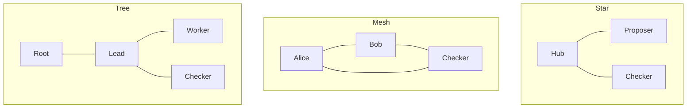

# Topologies and workflow examples

For a runnable mix of OpenAI GPT agents and a Python checker, start with the
[Compose mesh and reusable host runner](host-runner.md). Its configuration is
`examples/compose-mesh.json`; run it with `python -m mas_host` or Compose, not
`mas demo`. It provides explicit mock and live modes. The fixtures below remain
deterministic Rust exercises.

Run an example with `mas demo examples/star.json`. Every fixture uses the real
Rust codec and durable mailbox. Participants are deterministic functions: no
LLM, human approval, provider call or external effect is performed. Each receives
its addressed payload before producing its response. Transcripts retain the
wire messages, duplicate checks, restart redelivery and acknowledgements.

A graph controls permitted communication. A workflow controls when those edges
are used and how results are interpreted. Several workflows can use the same
graph. The JSON files specify directed edges explicitly; the diagrams abbreviate
paired directed edges with undirected lines.

## The three graph patterns



| Configuration | Exercise | Constraint |
|---|---|---|
| `star.json` | Hub obtains a candidate, then sends it to a checker. | Spokes cannot contact each other. Hub failure can stop the workflow. |
| `mesh.json` | Peers compute, check and report directly. | Direct exchange supplies no consensus or protection against shared reasoning errors. |
| `tree.json` | Root delegates to a lead; the lead delegates computation and checking. | Each nested task has its own request/reply identities; the lead explicitly returns the combined result. |

## Further glossary patterns

| Configuration | Exercise | Scope |
|---|---|---|
| `evaluator-optimiser.json` | Candidate changes in response to evaluator feedback; both acceptance and iteration exhaustion are exercised. | Maximum rounds; exhausted search returns unresolved. |
| `human-review.json` | Simulated approval allows a fixture request to an executor; rejection ends unresolved. | Actor names and graph edges do not authenticate a human or enforce general action approval. No external action occurs. |
| `orchestrator-workers.json` | Required work is planned from the supplied input and allocated to registered workers. | Input-dependent planning is shown by deterministic logic. Worker membership is frozen; live spawning is a host responsibility. |
| `sequential-crew.json` | Researcher, writer and reviewer pass explicit context through a pipeline. | Stage outputs become later inputs. |
| `swarm-handoff.json` | Peers pass context around a handoff sequence. | The fixture has one active stage. The mailbox does not enforce globally exclusive control or shared-memory consistency. |

Centralised orchestration, coordinator and supervisor refer to the star use
case here; manager/worker describes roles in a star or tree. Emergent
orchestration and peer agents map to peer exchange. Group chat can use explicit
per-recipient fan-out over an allowed graph; shared histories and speaker
selection remain host policies. Human-as-reviewer and human-as-arbiter differ in
when an adapter requests a decision, not the envelope syntax. A single agent is
a useful baseline but requires no inter-agent exchange. These mappings cover
glossary entries without inventing a separate graph for every synonym.

## The five workflow families

The requested [workflow catalogue](https://buildingeffectiveagents.com/patterns/)
points to [Anthropic's primary account](https://www.anthropic.com/engineering/building-effective-agents).
The examples cover all five families, with both parallelisation variants:

| Configuration | Distinguishing behaviour |
|---|---|
| `prompt-chaining.json` | Each stage consumes the previous output; a failed gate produces unresolved instead of dispatching the next task. |
| `routing.json` | Input categories choose distinct specialists; an unsupported category remains unresolved. |
| `parallel-sectioning.json` | Independent requests coexist before replies are consumed; results are aggregated by task identity despite reverse completion order. |
| `parallel-voting.json` | Three fixtures assess the same input; a two-vote threshold yields a decision, while insufficient agreement remains unresolved. Agreement is not evidence of truth by itself. |
| `orchestrator-workers.json` | The input changes the plan; fixed fan-out alone would be sectioning. |
| `evaluator-optimiser.json` | Evaluator feedback changes the candidate within a finite round budget. |

The orchestrator fixture accepts an optional `input.documents` array in its JSON
configuration; each document specifies `id`, `text` and `required_operations`
(`word-count` or `uppercase`). Different inputs produce different plans. This
field is fixture input, not part of the `mas init` run configuration.

The parallel fixtures establish overlapping outstanding work and order-independent
correlation. They do not measure simultaneous model execution, latency, cost or
quality improvement. Composition uses the same Request/Result semantics: a routed
worker can run a chain, an orchestrator can request review, and a tree lead can
collect parallel sub-results. Such compositions require their own finite bounds
and acceptance rules before broader verification claims.

## Failure and recovery

```sh
cargo run --release --locked --manifest-path rust-protocol/Cargo.toml --example recovery
```

This additional Rust example fills a one-slot mailbox and spends the entire
one-message budget, then leaves its request unanswered. After the one-second run
deadline it reopens the database and reconciles. The task becomes
`expired_outcome_unknown` without a worker reply or another accepted message.
Its queued request is returned as non-actionable history, an identical resend
retains its original sequence, and acknowledgement still drains the mailbox.
`make examples` records the result in `evidence/examples/recovery.json`.

The twelve workflow fixtures also check that each received Request is actionable
before computing its output, including after restart. A receipt remains a
snapshot: concurrent cancellation can still arrive after that check. An external
effect adapter needs its own idempotency or cancellation contract.

For credential provisioning, authenticated requests, spoofing rejection and
persistent attempt limits, follow the executable [gateway example](gateway.md).
That path derives identities from capabilities; the topology fixtures exercise
the trusted embedded API.
