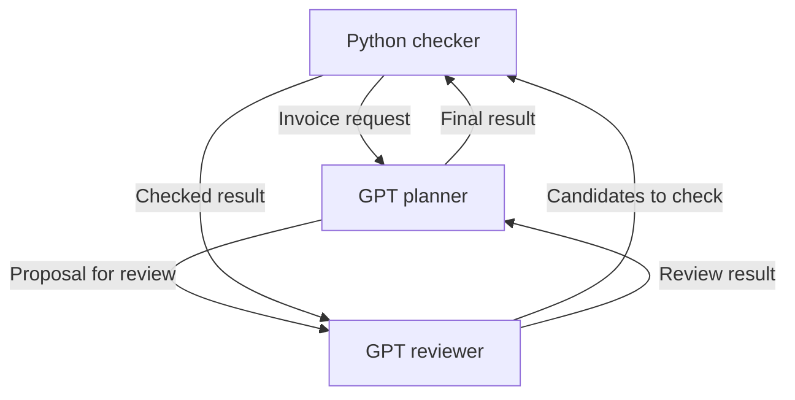

# Reusable host runner and Compose mesh

The Python host connects model and tool adapters to the existing Rust protocol.
Rust still owns encoding, route permissions, task transitions, call reservations,
expiry and durable storage. Python owns application scheduling and provider calls.
You can use the host as a library or run the supplied Compose example.

## Run without an API key

Install Docker Engine with Compose v2, or Docker Desktop, then run from the
repository root:

```sh
docker compose up --build --abort-on-container-exit --exit-code-from mesh
```

This builds the Rust binaries and Python host and runs a **mock** mesh. It makes
no provider requests. The mock adapters use the same Rust gateway, task flow and
call-accounting path as the live adapters. The final report labels the mode and
shows the checked result and communication events. Repeating the command creates
a new run; it does not resume an interrupted provider call.

## Run two GPT agents and a Python checker

Supply your OpenAI API key in the host shell. In Bash, this prompts without
echoing the key or putting its value into shell history:

```bash
read -rsp 'OpenAI API key: ' OPENAI_API_KEY
export OPENAI_API_KEY
docker compose -f compose.yaml -f compose.openai.yaml up --build --abort-on-container-exit --exit-code-from mesh
unset OPENAI_API_KEY
```

This explicitly selects live mode and makes paid API calls. Missing credentials
fail before any model request; live failures never silently switch to mocks.
Compose takes the key from the host environment and creates a private secret file
readable by the non-root host process. It does not add the key to the container
environment. The provider adapter reads that file; the key is never put in
protocol messages, model prompts or result reports. Other shells can set
`OPENAI_API_KEY` using their own secure input mechanism.

The mock service uses a read-only root filesystem. Compose requires a writable
root filesystem to install an environment-sourced secret, so the live override
enables that. The process still runs as UID 10001, with no added capabilities or
privilege escalation; application and system directories remain root-owned.

Copy `.env.example` to `.env` to change the model names. The defaults are
`gpt-4.1-mini` for the planner and `gpt-4o-mini` for the reviewer. Both support the
Responses API and structured outputs. Your account must have access to the
selected models. Model selection changes execution behaviour, not protocol
identity or routing permissions.

## What the example does

The task is deliberately easy to check: calculate an invoice total in integer
cents. This demonstrates communication and independent validation, not a claim
that several models improve arithmetic or outperform one model.

| Actor | Adapter in live mode | Responsibility |
|---|---|---|
| `planner` | OpenAI GPT | Propose the invoice total, then request peer review. |
| `reviewer` | A separate OpenAI GPT request | Assess the invoice and proposal, then ask the checker to validate them. |
| `checker` | Deterministic Python | Recompute the exact total and report whether the candidates agree with it. |



All six directed edges in `examples/compose-mesh.json` carry messages. Every
delegation creates its own task and request identity. Results correlate with
the original request, and the Rust gateway admits each operation under the
appropriate actor capability. There is no shared conversation history between
the GPT roles; each sees its addressed task data and its own fixed instructions.

This is a **logical mesh on a central durable transport**. Compose runs one
trusted host container, with a Rust gateway subprocess and separate model calls.
It does not provide peer-to-peer network transport or isolate arbitrary Python
plugins from one another. There are no published ports and no new HTTP protocol.

## Write an adapter

Install Python 3.10 or newer and the Rust binaries, then install the host:

```sh
cargo build --release --locked --manifest-path rust-protocol/Cargo.toml
python -m pip install ./host
export PATH="$PWD/rust-protocol/target/release:$PATH"
```

For native OpenAI execution, also install the pinned SDK dependencies:

```sh
python -m pip install -r host/requirements-openai.txt
```

An adapter implements one method. The host provides the addressed request and an
actor-bound context. The following complete example needs no model provider:

```python
from pathlib import Path
from mas_host import Outcome, Runner

class Uppercase:
    def handle(self, context, request):
        if request.operation != "uppercase":
            raise ValueError("unsupported operation")
        return Outcome({"text": request.input["text"].upper()})

topology = {
    "agents": ["client", "worker"],
    "edges": [["client", "worker"], ["worker", "client"]],
    "application": "agent-task/1",
    "mailbox_capacity": 10,
    "max_messages": 20,
    "max_bytes": 65536,
    "max_calls": 4,
    "wall_seconds": 120,
}

with Runner(topology, {"client": Uppercase(), "worker": Uppercase()},
            state_dir=Path(".mas-state")) as runner:
    result = runner.request("client", "worker", "uppercase", {"text": "hello"})
    print(result.output)
```

Use `context.request(peer, operation, input)` inside a handler to delegate work.
It sends and consumes a real Request/Result exchange. A peer reply needs the
reverse directed edge as well as the request edge. All requests and replies go
through the Rust encoder and authenticated gateway.

Wrap external invocations with `context.invoke(callable)`. The callable returns
`Invocation(output={...}, evidence={...})`. The runner reserves a durable call
before invoking it and records evidence afterwards. The OpenAI adapter supplies
the response ID, selected model and available token counts; it disables automatic
SDK retries. Custom adapters must provide their own provider timeout and evidence
policy. Calls made outside this interface are outside its accounting.

The adapter interface is ordinary trusted Python code. It can wrap another model
provider, a deterministic tool or an application-specific human input service.
Do not load untrusted code into this process. Context objects are an API boundary,
not a Python sandbox. Model output is data: the example never evaluates generated
Python, shell commands or model-selected tools.

## Reuse across topologies

| Topology | Configuration and workflow |
|---|---|
| Star | Permit hub↔worker pairs; the hub calls each worker adapter. |
| Mesh | Permit the peer pairs required by the workflow; adapters delegate directly. |
| Tree | Permit parent↔child pairs; a lead adapter delegates to its children. |
| Pipeline or review loop | Permit stage/reviewer pairs, including reply edges; bound delegation depth and rounds. |

Topology does not select adapters or schedule work by itself. Bind every actor
to an adapter and supply the application workflow. Membership, routes and runtime
budgets are frozen for each run. This runner schedules requests synchronously;
it supports bounded nested delegation, not concurrent fan-out or a distributed
worker pool. The existing Rust fixtures demonstrate additional workflow patterns.

## Persistence, failures and scope

Compose keeps each private run directory in a named state volume. Each contains
the SQLite database, capability configuration and report. Treat the volume as
sensitive application state. Deleting a container does not delete the volume.
Do not use `docker compose down --volumes` when you need to retain it.

The runner acknowledges a Request after a terminal outcome is committed, then
receives and acknowledges the correlated reply. On an adapter exception it tries
to record a sanitised Failure. Exhausted budgets or expiry can prevent a reply;
status inspection reconciles expiry and the host exits unsuccessfully. A protocol
Failure says that the adapter could not complete its work; it cannot establish
that an external provider or tool had no effect.

There is deliberately no automatic recovery that repeats provider execution.
After a crash or ambiguous timeout, inspect the retained call reservation and
provider execution evidence. A fresh Compose run starts a fresh job and can
incur fresh charges. Production side effects require provider-specific
idempotency and reconciliation. Protocol deadlines reject late completion; they
do not forcibly interrupt arbitrary Python handlers or cancel remote work.

Tests exercise the host against the actual Rust binaries, plus simulated OpenAI
responses for refusal, incomplete output and invalid data. The Compose CI job
builds the image and runs the mock mesh. These checks do not establish live model
quality, account availability, billing or exactly-once external execution.
The existing SPIN evidence covers its documented finite protocol models; it
does not verify Python, the OpenAI SDK or Docker isolation.

## API and packaging references

- [OpenAI Responses API](https://developers.openai.com/api/reference/python/resources/responses)
- [OpenAI structured outputs](https://developers.openai.com/api/docs/guides/structured-outputs)
- [GPT-4.1 mini](https://developers.openai.com/api/docs/models/gpt-4.1-mini)
- [GPT-4o mini](https://developers.openai.com/api/docs/models/gpt-4o-mini)
- [Docker Compose secrets](https://docs.docker.com/compose/how-tos/use-secrets/)

These references were consulted on 13 October 2026. Credentials are supplied at
runtime, never during image construction.
